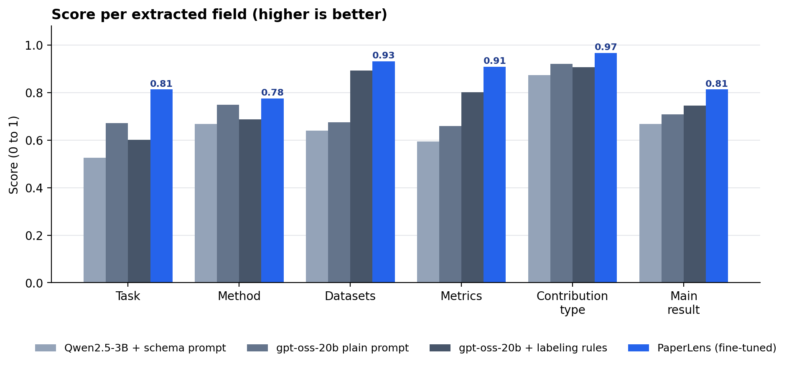
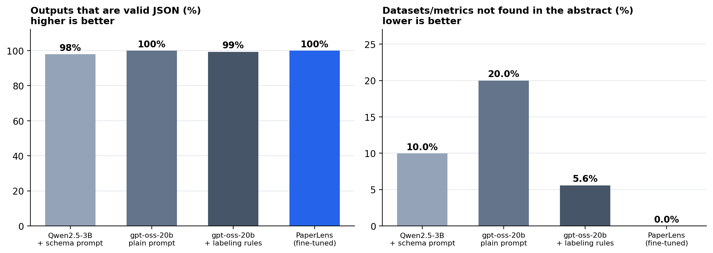

<div align="center">

# PaperLens

**A small language model, fine-tuned to turn an ML paper's abstract into structured JSON.**

[](https://huggingface.co/punit-09/paperlens-qwen2.5-3b-qlora)
[](https://huggingface.co/datasets/punit-09/paperlens-arxiv-abstracts)
[](LICENSE)

</div>

PaperLens reads the title and abstract of a machine-learning paper and returns six fields: the **task**, the **method**, the **datasets**, the **metrics**, the **main result** and the **contribution type**. It is Qwen2.5-3B-Instruct, fine-tuned with QLoRA on a free Kaggle GPU.

Large general models can extract these fields too, but their output drifts in format and naming, and they sometimes list datasets or metrics that are not in the text. This project tests whether a small model trained for one narrow task can be more consistent and more faithful to the source.

## Results at a glance

| | Qwen2.5-3B + schema prompt | gpt-oss-20b + labeling rules | **PaperLens** |
|---|:---:|:---:|:---:|
| Overall score (0 to 1) | 0.66 | 0.77 | **0.87** |
| Valid JSON | 98% | 99% | **100%** |
| Datasets/metrics not found in the abstract | 10.0% (26/261) | 5.6% (9/161) | **0.0% (0/118)** |

Measured on 150 held-out abstracts. The overall score is the average of six per-field scores (text overlap for task, method and result; set overlap for datasets and metrics; accuracy for contribution type), and invalid JSON scores 0. Against gpt-oss-20b given the labeling rules, PaperLens is ahead by **+0.10 (95% CI +0.07 to +0.12)** (95% confidence interval, paired). PaperLens is statistically tied (the confidence interval of the difference includes 0) on: method (vs gpt-oss-20b, plain prompt); datasets (vs gpt-oss-20b, rules prompt).






> **How to read these numbers.** Scores measure *agreement with LLM-generated reference labels*, not human ground truth. PaperLens was trained on the same labeling conventions, so part of its advantage on task and method is style. gpt-oss-20b is a larger open-weight model run via the Groq API (temperature 0, one run per prompt); its rules prompt was written by me to approximate the labeling rules.

## Example

**Title:** *Longer is (Not Necessarily) Stronger: Punctuated Long-Sequence Training for Enhanced Speech Recognition and Translation*

**Abstract (shortened):** *This paper presents a new method for training sequence-to-sequence models for speech recognition and translation tasks. Instead of the traditional approach of training models on short segments containing only lowercase or partial punctuation and capitalization (PnC) sentences, we propose training on longer utterances that include complete sentences with proper punctuation and capitalization. We achieve this ...*

PaperLens output:

```json
{
  "task": "speech recognition and translation",
  "method": "punctuated long-sequence training",
  "datasets": [
    "Earnings-21",
    "Earnings-22"
  ],
  "metrics": [
    "WER"
  ],
  "main_result": "Training on sequences longer than 40 seconds shows a 25% relative word error rate improvement on the Earnings-21 and Earnings-22 benchmarks.",
  "contribution_type": "new_method"
}
```

## How it works


1. **Collect.** A random sample of arXiv papers (cs.LG, cs.CL, cs.CV; 2023 to 2026): 1,499 for training, 100 for validation and 150 for testing, with no overlap between splits.
2. **Label.** The Gemini API labels each paper with one fixed rule prompt (temperature 0).
3. **Filter.** Labels are checked in code before use: every dataset and metric must appear in the title or abstract, model names are not accepted as datasets, vague "metrics" such as cost or latency are removed, and any number in the result sentence must exist in the abstract.
4. **Fine-tune.** QLoRA on Qwen2.5-3B-Instruct, 2 epochs (186 steps, about 30 minutes on a free T4).
5. **Evaluate.** Six per-field scores, bootstrap confidence intervals, and paired comparisons against three baselines.
6. **Release.** Model, dataset, saved predictions and results are public on Hugging Face.

## Engineering notes

- **Faithfulness is enforced, not assumed.** The label filters above remove unsupported entries, and the evaluation reports how often each system names datasets or metrics that are not in the text.
- **Efficient on a small GPU.** The loss is computed only on the JSON answer, and the vocabulary projection runs only on those positions. Batches are grouped by length, and gradient checkpointing keeps peak memory near 5 GB.
- **Built to survive crashes.** Free Kaggle sessions die often, so checkpoints go to Hugging Face every 25 steps and training resumes at the exact step.
- **Honest evaluation.** Confidence intervals come from bootstrapping the test rows, comparisons are paired, and ties are reported instead of hidden.

## Honest notes

- Labels are LLM-generated and contain errors, and the noise rate is unmeasured. I reviewed 30 of the 150 test rows and corrected two labels; train and validation labels were not reviewed row by row.
- One training run, one seed. A few test abstracts were looked at while the labeling rules were designed (the model never trained on them).
- Narrow data: English ML abstracts from three arXiv categories, about 80% describing a new method. Behaviour on other fields was only tried informally on a couple of papers, with no measured results.
- Speed: about 13 seconds per abstract on a T4 (batch size 1, 4-bit base model with an unmerged adapter). This setup is not optimized for latency.
- The labeling rules deliberately exclude latency, FPS and generic task names from `metrics` and `datasets`, so the model does too.

## Use it

The adapter and a tested loading snippet are on the [model card](https://huggingface.co/punit-09/paperlens-qwen2.5-3b-qlora). The notebook also contains a small Gradio app: paste a title and abstract (or upload a PDF) and get the JSON, a validity check and a warning for dataset or metric names not found in the text.

<!-- After adding a screenshot as docs/demo.png, remove this comment markup:

-->

## Repository

```text
paperlens/
├── README.md
├── docs/                      figures used in this README
├── results/                   results_final.json, results_table.md
├── src/paperlens_eval.py      scoring code
├── notebooks/paperlens.ipynb  the full pipeline as I ran it
├── requirements.txt
└── LICENSE
```

## Reproduce

Open `notebooks/paperlens.ipynb` on Kaggle with a free T4 GPU. It covers sampling, labeling, training, evaluation and the demo. Tested with transformers 5.16, peft 0.21, bitsandbytes 0.50 and torch 2.11. The labeled data is public (link above), so you can skip the labeling step.

## License and attribution

Code: MIT (see `LICENSE`). The model adapter is **Improved using Qwen** and is distributed under the Qwen RESEARCH LICENSE AGREEMENT, so it is for non-commercial research or evaluation use only. Labels were generated with the Gemini API; check Google's current terms before using them to train models. Paper text comes from arXiv metadata (CC0), and rights in each paper belong to its authors.
