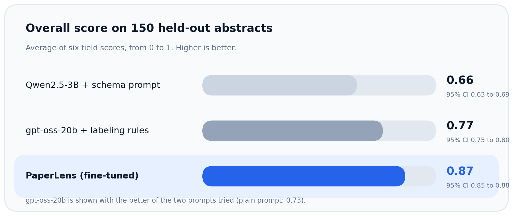
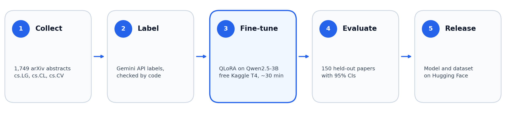

<div align="center">

# PaperLens

### Turning research abstracts into structured, machine-readable knowledge.

A fine-tuned small language model that extracts the task, method, datasets, metrics, main result and contribution type from machine learning paper abstracts.

**0.87 overall score (untuned base model: 0.66)** · **100% valid JSON** · **3B parameters, trained on a free GPU**

[**Model**](https://huggingface.co/punit-09/paperlens-qwen2.5-3b-qlora) · [**Dataset**](https://huggingface.co/datasets/punit-09/paperlens-arxiv-abstracts) · [**Training Notebook**](notebooks/paperlens.ipynb)


</div>

---

## The problem

Research papers contain the same kinds of facts (datasets, evaluation metrics, results), but each paper words them differently, which makes them tedious to collect into a consistent structure. PaperLens tests whether a small, fine-tuned language model can do this extraction reliably.

Given a paper's title and abstract, it returns six fields:

| Field | What it captures |
|---|---|
| `task` | The research problem being addressed |
| `method` | The proposed approach or technique |
| `datasets` | Datasets mentioned in the abstract |
| `metrics` | Evaluation metrics reported |
| `main_result` | The main finding or quantitative result |
| `contribution_type` | The type of research contribution |

**Example:** output of the fine-tuned model on a held-out test paper ([arXiv:2305.12912](https://arxiv.org/abs/2305.12912)):

```json
{
  "task": "imbalanced semi-supervised learning",
  "method": "Balanced Memory Bank (BMB)",
  "datasets": ["ImageNet127", "ImageNet-LT"],
  "metrics": [],
  "main_result": "BMB surpasses state-of-the-art approaches by clear margins, for example 8.2% on the 1% labeled subset of ImageNet127 and 4.3% on the 50% labeled subset of ImageNet-LT.",
  "contribution_type": "new_method"
}
```

*The abstract names no evaluation metric, so `metrics` is empty. Extracted claims should still be checked against the original paper.*

## Results at a glance

Evaluated on **150 held-out abstracts**, PaperLens scores **0.87** overall, ahead of both baselines (+0.096 over gpt-oss-20b, 95% CI +0.075 to +0.117).



### Field-level evaluation

Scores range from 0 to 1; higher means closer agreement with the reference labels.

| Field | Untuned Qwen2.5-3B + schema prompt | gpt-oss-20b + labeling rules | **PaperLens** |
|:---|:---:|:---:|:---:|
| Task | 0.53 | 0.60 | **0.81** |
| Method | 0.67 | 0.69 | **0.78** |
| Datasets | 0.64 | 0.89 | **0.93** † |
| Metrics | 0.59 | 0.80 | **0.91** |
| Contribution type | 0.87 | 0.91 | **0.97** |
| Main result | 0.67 | 0.75 | **0.81** |
| **Overall** | **0.66** | **0.77** | **0.87** |

† Statistical tie with gpt-oss-20b: the confidence interval of the difference includes 0.

### Output reliability

| Measure | Untuned Qwen2.5-3B + schema prompt | gpt-oss-20b + labeling rules | **PaperLens** |
|:---|:---:|:---:|:---:|
| Valid JSON output | 98% | 99% | **100%** |
| Datasets/metrics not found in the abstract | 10.0% (26/261) | 5.6% (9/161) | **0.0% (0/118)** |

**How to interpret these results:** scores measure agreement with LLM-generated reference labels, not independently verified human ground truth, and PaperLens was trained in the same labeling style. I manually reviewed 30 of the 150 test examples. gpt-oss-20b is shown with the better of the two prompts I tried.

## How it works



1. **Collect:** 1,749 arXiv abstracts from `cs.LG`, `cs.CL` and `cs.CV` (2023 to 2026), split into train, validation and test with no overlap.
2. **Label:** structured labels from the Gemini API, filtered by code so that every dataset and metric must appear in the text.
3. **Fine-tune:** QLoRA on Qwen2.5-3B-Instruct, about 30 minutes on a free Kaggle T4 GPU.
4. **Evaluate:** 150 held-out papers, six per-field scores, 95% bootstrap confidence intervals.
5. **Release:** model and dataset published on Hugging Face.

To run the model yourself, see the loading snippet on the [model card](https://huggingface.co/punit-09/paperlens-qwen2.5-3b-qlora). The full pipeline is in the [notebook](notebooks/paperlens.ipynb).

## Limitations

- **Reference-label quality:** labels were generated by an LLM and may contain errors; the noise rate has not been measured.
- **Limited scope:** English abstracts from three arXiv categories, one training run.
- **Speed:** about 13 seconds per abstract on a T4 (4-bit model, unmerged adapter). This setup is not optimized for latency.
- **Not a verified knowledge source:** the model can omit, misread or wrongly extract claims, so outputs should be checked before downstream use.

## License and attribution

- **Code:** MIT. See [`LICENSE`](LICENSE).
- **Model:** **Improved using Qwen.** Fine-tuned from Qwen2.5-3B-Instruct and released under the Qwen Research License, which restricts use to non-commercial purposes.
- **Dataset:** labels were generated with the Gemini API. Check Google's terms before reusing or redistributing them.
